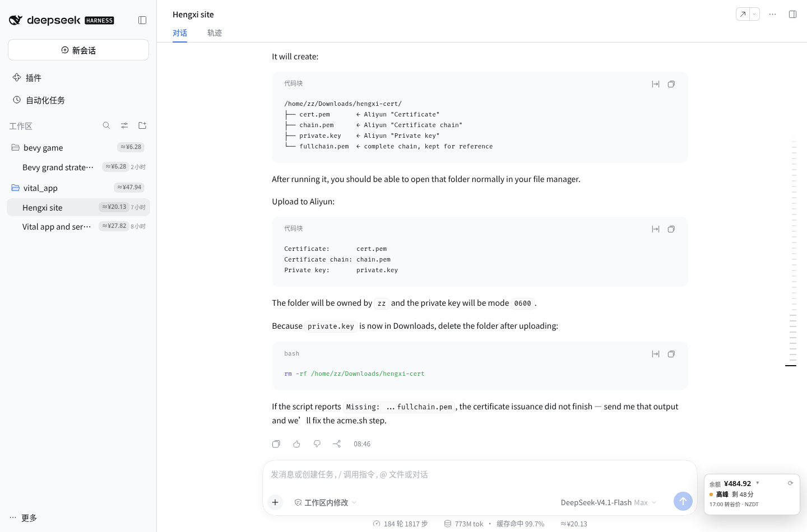

# dsh-balance

**English** | [简体中文](README.zh.md)

A [DeepSeek Harness](https://github.com/deepseek-ai/deepseek-harness) (DSH) web
plugin that shows your **real DeepSeek account balance** and the **current
peak/off-peak pricing window** in a window-anchored card, and estimates the
**cost of every conversation and workspace** from the session log.



## Features

- **Balance card** — fixed to the bottom-right of the window, independent of the
  composer: live account balance, current window (`谷价` / `高峰`), remaining
  time, and the next switch in your local timezone. It stays at the window
  bottom even on the no-conversation/hero screen, and moves above the composer
  or the per-conversation status row when they reach that corner, so it never
  covers other readings.
- **Native detail panel** — click the card to open a menu-style panel above it:
  account balance / topped-up / granted, next switch in local and Beijing time,
  current local/Beijing time, peak hours, price-table source and update time,
  ledger path, and a refresh button. The granted row only appears while some
  granted credit remains and links to the Billing page for its expiry. Closes on
  outside click or `Esc`.
- **Cost estimates** — per-conversation and per-workspace estimates in the
  sidebar, summed from a persistent ledger that records each usage event once.
- **Dynamic pricing** — CNY and USD price tables and the peak-hour windows are
  fetched from the official DeepSeek pricing pages; the Chinese holiday calendar
  comes from `api.apihubs.cn`.
- **Theme and language aware** — uses the DSH menu-surface design tokens
  (light/dark, radius, type scale), follows the DSH UI language
  (`zh-*` / English).
- **Peak-switch notifications** — optional browser notification when the window
  changes, only if notification permission was already granted for the DSH site.

## Requirements

- **DSH 0.2.1.x** with the web profile. Tested with `0.2.1-rc.3`; the package
  declares `engines.dsh = ">=0.2.1-0 <0.2.2-0"` and DSH refuses to mount it on
  other lines.
- Node.js `^22.19.0 || >=24.0.0` (the DSH requirement).
- A DeepSeek API key configured in DSH's credentials as `DEEPSEEK_API_KEY`.

## Install

Install this repository directly from GitHub:

```bash
dsh plugin --profile web add github:zz0-0/dsh-balance
systemctl --user restart dsh-web
```

Or with an explicit git URL:

```bash
dsh plugin --profile web add git+https://github.com/zz0-0/dsh-balance.git
systemctl --user restart dsh-web
```

Then **hard-refresh** the DSH web page (`Ctrl/Cmd + Shift + R`). The plugin
injects its browser script into the DSH index page, so the refresh is needed the
first time. The `systemctl` line assumes the Linux user service; if you run
`dsh web` manually, restart that process instead.

> **Not the npm package.** The npm package named `dsh-balance` is an unrelated
> project by another author. Install this plugin with the GitHub coordinate
> above, not with `dsh plugin add dsh-balance`.

### Update

```bash
dsh plugin --profile web add github:zz0-0/dsh-balance
systemctl --user restart dsh-web
```

### Remove

```bash
dsh plugin --profile web remove dsh-balance
systemctl --user restart dsh-web
```

## Usage

Click the balance card in the bottom-right corner to open the detail panel.
The card itself shows the total balance, the current pricing window, the
countdown to the next switch, and that switch time in your local zone.

The sidebar shows an `≈¥…` estimate on each conversation row and the sum of its
conversations on each workspace row. Hovering a badge shows its tokens and the
recorded estimate.

There is deliberately **no cost pill in the composer status row**: that row is
per-conversation and gets crowded quickly, and the conversation row already
carries the estimate.

If notification permission was granted for the DSH site, the browser notifies
when the peak/off-peak window changes while the DSH tab is open. A fully closed
browser cannot receive notifications.

## Pricing and the ledger

### Pricing is fetched, not hardcoded

At startup and whenever the cached table is older than six hours, the host
fetches both official pricing pages:

| Currency | Page |
|---|---|
| CNY | `https://api-docs.deepseek.com/zh-cn/quick_start/pricing` |
| USD | `https://api-docs.deepseek.com/quick_start/pricing` |

The parser reads the model pricing table dynamically, including the model
columns, cache-hit/cache-miss/output prices, and the peak-hour windows from the
Chinese page footnote. If a page changes shape and parsing fails, the previous
cache is kept and the detail panel marks the source as `缓存/默认`
(`cache/default`).

### Peak windows

Peak is Beijing weekday **09:00–12:00** and **14:00–18:00**. Weekends are
always off-peak (from 2026-08-23), and a weekday marked as a public holiday is
off-peak. A make-up weekend is still a weekend, so it is off-peak.

The holiday calendar is fetched from:

```
https://api.apihubs.cn/holiday/get?year=YYYY&size=500
```

for the current and next year, and cached for 30 days.

### The ledger never reprices old spend

The cost ledger is `~/.dsh/.dsh-balance-costs.json`. Each session entry stores:

- `costs.CNY` and `costs.USD`
- `tokens`
- `lastSeq` — the last event already recorded
- `pricingVersions` — price snapshots used for its recorded events
- `calendarVersions` — holiday calendars used for its recorded events

When a session is scanned again, only events with `seq > lastSeq` are priced.
Already-recorded events are never recalculated, so a price change affects only
**new** events and a restart cannot rewrite what was already spent.

### Currency

`/user/balance` can return multiple `balance_infos`. The plugin stores costs in
both CNY and USD, then displays the bucket for the primary account currency: the
**largest non-zero balance** returned by the API (CNY wins a tie). If both
currencies have a positive balance, the card shows both stacked while estimates
use the larger one. A USD-only account uses the USD pricing table and `$`
badges.

**Granted credit expiry.** The official balance API reports only the unexpired
granted total, not per-grant expiry dates. The panel therefore links the granted
row to the DeepSeek Billing page (`https://platform.deepseek.com/transactions`)
while a granted balance exists, and hides the row once it reaches zero.

## How it works

The plugin is a DSH bundle: `package.json` declares
`dsh.bundle.patch = ./cordis.patch.yml`, and that patch inserts the
`dsh-balance` entry into the web profile. It has two halves:

| Half | File | Role |
|---|---|---|
| Host | `lib/index.js` | Resolves `DEEPSEEK_API_KEY` through DSH credentials, queries `/user/balance`, reads session events, keeps the ledger, fetches prices/holidays, serves `GET /dsh-balance/data` and `GET /dsh-balance/client.js`. |
| Browser | `client.js` | Injected into the DSH index page. Draws the balance card and detail panel, and adds cost badges to conversation/workspace rows. |

The browser only talks to the local DSH server. The API key never reaches the
browser.

Cache files, all under `~/.dsh/` (or `$DSH_HOME`):

- `.dsh-balance-costs.json` — the cost ledger
- `.dsh-balance-pricing.json` — current price table and peak hours
- `.dsh-balance-pricing-history.json` — one entry per changed price snapshot
- `.dsh-balance-holidays.json` — current holiday calendar

## Privacy

- **Outbound requests**: `api.deepseek.com/user/balance` (with your API key),
  the two DeepSeek pricing pages, and `api.apihubs.cn/holiday/get`. Nothing
  else, and no telemetry.
- **Local-only**: the ledger and caches stay in `~/.dsh/`. The browser only
  requests `/dsh-balance/data` from your local DSH server.
- **Credential handling**: the key is resolved host-side through DSH's
  credentials service and is never serialized into the browser payload.

## Troubleshooting

- **Card shows `余额?` / `Balance?`** — `DEEPSEEK_API_KEY` is missing or invalid;
  check DSH's credentials configuration and the host log.
- **Price source says `缓存/默认`** — the pricing page could not be fetched or
  parsed; the last cached table is still used.
- **No notifications** — permission was not granted for the DSH site, or the tab
  is closed.
- **Plugin not visible after install** — restart the `dsh web` process and
  hard-refresh the browser. Verify the profile lists the plugin.
- **Install refused with an incompatible-version error** — the package declares
  `engines.dsh` for the DSH 0.2.1 line only.

## Development

The plugin has no build step: plain ESM on the host and a classic browser script.

```bash
git clone https://github.com/zz0-0/dsh-balance.git
cd dsh-balance
dsh plugin --profile web add link:$(pwd)
systemctl --user restart dsh-web
```

- `client.js` is served with `Cache-Control: no-store`. With a `link:` install,
  edit and hard-refresh the browser.
- `lib/index.js` is host-side: edit and restart `dsh-web`.
- A git install keeps its own copy under the profile's `node_modules`; after
  editing the checkout, reinstall the plugin (or sync `client.js` into the
  installed package) and refresh.

### Files

| File | Role |
|---|---|
| `package.json` | DSH bundle metadata and compatibility |
| `cordis.patch.yml` | Inserts the plugin into the web profile |
| `lib/index.js` | Host: balance, pricing, holidays, ledger, HTTP routes, client injection |
| `client.js` | Browser: balance card + detail panel, row badges, notifications |
| `screenshot.png` | README screenshot |

### UI integration

The browser side does not patch React. It uses stable attributes exposed by the
workspace sidebar and composer:

- `[data-row-key="session:<sessionId>"]` and `[data-row-key="workspace:<workspaceId>"]`
  for cost badges (re-added by a `MutationObserver` after React re-renders)
- `[data-composer-card]` and `[data-slot="conversation.composer.dock"]` to keep
  the window-anchored card clear of the composer and the status row

## License

[MIT](LICENSE)
