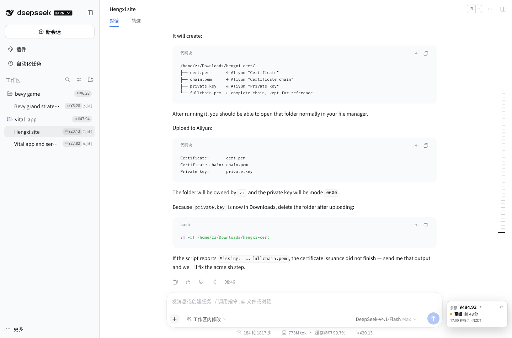

# dsh-balance

**English** | [简体中文](README.zh.md)

A [DeepSeek Harness](https://github.com/deepseek-ai/deepseek-harness) (DSH) web
plugin that shows your **real DeepSeek account balance** and the **current
peak/off-peak pricing window** as one compact reading in the sidebar footer,
and estimates the **cost of every conversation and workspace** from the session
log. The reading sits on one 26 px line above Settings inside the sidebar, in
the page's own layout, so it never covers the conversation, the composer, or a
file open in the right panel.



*Screenshot: the detail panel. The chip it opens from now lives in the sidebar
footer; the capture predates that move.*

## Features

- **Sidebar-footer reading** — one chip above Settings, left of the
  service-status chip: live account balance and the countdown to the next
  pricing switch, in a single 22 px line that follows the sidebar's own type
  (inherited family, the theme's secondary content size). The dot colour says
  which window is running — green for `谷价`, amber for `高峰` — so the chip
  spends its width on the time instead of the word. It adds one 26 px line
  directly above the Settings trigger (below the footer's own action row, so the
  session list scrolls a little more) instead of floating over the content, and
  it is visible on the hero screen and in every session. In the 56 px rail the
  whole line hides. On windows narrower than 768 px the sidebar is a drawer, so
  the reading is visible while that drawer is open.
- **Native detail panel** — hover or click the chip to open a menu-style panel above the footer (click pins it; the `×`, hover away, click outside, or `Esc` closes): a summary line with the dot, balance, window and countdown; then account balance / topped-up / granted, next switch in local and Beijing time, current local/Beijing time, peak hours, price-table source and update time, ledger path, and a foot with a link to the official pricing page plus a refresh button. The granted row is always shown (`0` when empty) and links to the Billing page for its expiry while some granted credit remains.
- **Cost estimates** — per-conversation and per-workspace estimates in the
  sidebar, summed from a persistent ledger that records each usage event once.
- **Dynamic pricing** — CNY and USD price tables and the peak-hour windows are
  fetched from the official DeepSeek pricing pages. The holiday calendar is
  opt-in (`DSH_BALANCE_HOLIDAYS=1`); without it only weekends are valley.
- **Theme and language aware** — uses the DSH menu-surface design tokens
  (light/dark, radius, type scale), follows the DSH UI language
  (`zh-*` / English).
- **Peak-switch notifications** — optional browser notification when the window
  changes, only if notification permission was already granted for the DSH site.

## Requirements

- **DSH 0.2.x** (0.2.1 and 0.2.2 lines) with the web profile. Tested with
  `0.2.2-rc.1`; the package declares
  `engines.dsh = ">=0.2.1-0 <0.3.0-0"` and DSH refuses to mount it on other
  lines.
- Node.js `^22.19.0 || >=24.0.0` (the DSH requirement).
- A DeepSeek API key configured in DSH's credentials as `DEEPSEEK_API_KEY`.

## Install

Install this repository directly from GitHub:

```bash
dsh plugin --profile web add github:zz0-0/dsh-balance
systemctl --user restart dsh-web
```

Or with an explicit git URL:

```bash
dsh plugin --profile web add git+https://github.com/zz0-0/dsh-balance.git
systemctl --user restart dsh-web
```

Then **hard-refresh** the DSH web page (`Ctrl/Cmd + Shift + R`). The plugin
injects its browser script into the DSH index page, so the refresh is needed the
first time. The `systemctl` line assumes the Linux user service; if you run
`dsh web` manually, restart that process instead.

> **Not the npm package.** The npm package named `dsh-balance` is an unrelated
> project by another author. Install this plugin with the GitHub coordinate
> above, not with `dsh plugin add dsh-balance`.

### Update

```bash
dsh plugin --profile web add github:zz0-0/dsh-balance
systemctl --user restart dsh-web
```

### Remove

```bash
dsh plugin --profile web remove dsh-balance
systemctl --user restart dsh-web
```

## Usage

The balance reading is the left chip in the sidebar footer, just above
Settings: `● 余额 ¥471.62 · 5h59m` — the status dot, the amount, and the
countdown to the next switch; the dot's colour is the current window. Its text starts on the Settings trigger's column; the list rows
above sit deeper only because of their nesting indent. Hover it to open the detail panel, click to pin it open. The
panel opens upward from the chip over the bottom-left corner, so it never
touches the right-hand file panel; close it and the corner is back. Its summary
line spells the window out (`谷价` / `高峰`) with the long countdown, and its
foot links to the official pricing page.

The sidebar shows an `≈¥…` estimate on each conversation row and the sum of its
conversations on each workspace row. Hovering a badge shows its tokens and the
recorded estimate.

There is deliberately **no cost pill in the composer status row**: that row is
per-conversation and gets crowded quickly, and the conversation row already
carries the estimate.

If notification permission was granted for the DSH site, the browser notifies
when the peak/off-peak window changes while the DSH tab is open. A fully closed
browser cannot receive notifications.

## Pricing and the ledger

Pricing fetch, peak windows, the append-only ledger, currency handling, and the two halves: [ARCHITECTURE.md](ARCHITECTURE.md).

## Privacy

- **Outbound requests**: `api.deepseek.com/user/balance` (with your API key),
  the two DeepSeek pricing pages, and — only with `DSH_BALANCE_HOLIDAYS=1` —
  `api.apihubs.cn/holiday/get`. Nothing else, and no telemetry.
- **Local-only**: the ledger and caches stay in `~/.dsh/`. The browser only
  requests `/dsh-balance/data` from your local DSH server.
- **Credential handling**: the key is resolved host-side through DSH's
  credentials service and is never serialized into the browser payload.

## Troubleshooting

- **Chip shows `余额?` / `Balance?`** — `DEEPSEEK_API_KEY` is missing or invalid;
  check DSH's credentials configuration and the host log.
- **Price source says `缓存/默认`** — the pricing page could not be fetched or
  parsed; the last cached table is still used.
- **No notifications** — permission was not granted for the DSH site, or the tab
  is closed.
- **Plugin not visible after install** — restart the `dsh web` process and
  hard-refresh the browser. Verify the profile lists the plugin.
- **Install refused with an incompatible-version error** — the package declares
  `engines.dsh` for the DSH 0.2.x line only; update the plugin or DSH.

## Development

The plugin has no build step: plain ESM on the host and a classic browser script.

```bash
git clone https://github.com/zz0-0/dsh-balance.git
cd dsh-balance
dsh plugin --profile web add link:$(pwd)
systemctl --user restart dsh-web
```

- `client.js` is served with `Cache-Control: no-store`. With a `link:` install,
  edit and hard-refresh the browser.
- `lib/index.js` is host-side: edit and restart `dsh-web`.
- A git install keeps its own copy under the profile's `node_modules`; after
  editing the checkout, reinstall the plugin (or sync `client.js` into the
  installed package) and refresh.

### Files

| File | Role |
|---|---|
| `package.json` | DSH bundle metadata and compatibility |
| `cordis.patch.yml` | Inserts the plugin into the web profile |
| `lib/index.js` | Host: balance, pricing, holidays, ledger, HTTP routes, client injection |
| `client.js` | Browser: footer chip + detail panel, row badges, notifications |
| `screenshot.png` | README screenshot |

### UI integration

The browser side does not patch React. It uses stable attributes exposed by the
sidebar shell:

- `[data-row-key="session:<sessionId>"]` and `[data-row-key="workspace:<workspaceId>"]`
  for cost badges (re-added by a `MutationObserver` after React re-renders)
- `[data-slot="sidebar.settings"]` to find the footer column: one 26 px row is
  inserted directly above the Settings trigger. The footer's own action row
  already holds the stock Cordis occupant (a 42 px full-width flex item), so a
  second child there would be squeezed to nothing.
- `[data-sidebar-collapsed]` on the frame root to hide that row in the rail

## License

[MIT](LICENSE)
