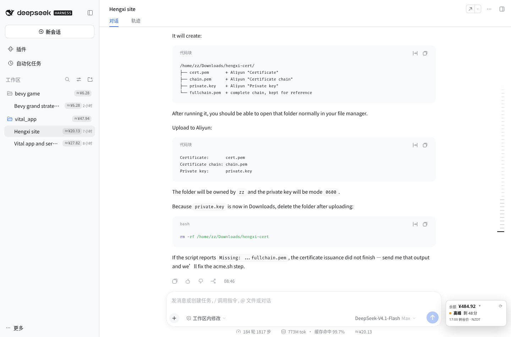

# dsh-balance

[English](README.md) | **简体中文**

一个 [DeepSeek Harness](https://github.com/deepseek-ai/deepseek-harness)（DSH）
Web 插件：在窗口右下角的卡片里显示 **DeepSeek 账户真实余额** 和 **当前峰谷计价
时段**，并从会话日志估算 **每个会话与工作区的费用**。



## 功能

- **余额卡片** — 固定在窗口右下角，不随输入框移动：实时账户余额、当前时段
  （`谷价` / `高峰`）、剩余时间，以及按本地时区显示的下次切换时间。在没有会话的
  欢迎页（hero）也停靠在窗口底部；当输入框或会话状态行到达右下角时，卡片会上移
  避让，不遮挡其他读数。
- **原生详情面板** — 点击卡片，在卡片上方打开与 DSH 菜单同风格的详情面板：账户
  余额 / 充值 / 赠送、按本地时间与北京时间显示的下次切换、当前本地/北京时间、
  高峰时段、价格表来源与更新时间、账本路径，以及刷新按钮。点击面板外部或按
  `Esc` 关闭。
- **费用估算** — 侧边栏中每个会话、每个工作区的估算费用，来自一份每条用量事件只
  记录一次、不会重新计价的持久账本。
- **动态价格** — CNY/USD 价格表与高峰时段从 DeepSeek 官方定价页抓取；中国节假日
  日历来自 `api.apihubs.cn`。
- **主题与语言** — 使用 DSH 菜单表面的设计变量（明暗主题、圆角、字号），并跟随
  DSH UI 语言（`zh-*` / English）。
- **峰谷切换通知** — 可选；仅当已为 DSH 站点授予通知权限时，在峰谷切换时发送浏览器
  通知。

## 环境要求

- **DSH 0.2.1.x**，并启用 Web profile。已在 `0.2.1-rc.3` 上测试；包内声明
  `engines.dsh = ">=0.2.1-0 <0.2.2-0"`，其他版本线上 DSH 会拒绝挂载。
- Node.js `^22.19.0 || >=24.0.0`（DSH 的要求）。
- 在 DSH 凭据中配置名为 `DEEPSEEK_API_KEY` 的 DeepSeek API Key。

## 安装

直接从 GitHub 安装：

```bash
dsh plugin --profile web add github:zz0-0/dsh-balance
systemctl --user restart dsh-web
```

或使用显式 git 地址：

```bash
dsh plugin --profile web add git+https://github.com/zz0-0/dsh-balance.git
systemctl --user restart dsh-web
```

然后 **硬刷新** DSH 页面（`Ctrl/Cmd + Shift + R`）。插件会把浏览器脚本注入 DSH
首页，所以第一次安装后需要刷新。上面的 `systemctl` 假设使用 Linux 用户服务；如果
直接运行 `dsh web`，请重启该进程。

> **不是 npm 上的那个包。** npm 上名为 `dsh-balance` 的是另一位作者的另一个项目。
> 请使用上面的 GitHub 地址安装本插件，不要执行 `dsh plugin add dsh-balance`。

### 更新

```bash
dsh plugin --profile web add github:zz0-0/dsh-balance
systemctl --user restart dsh-web
```

### 卸载

```bash
dsh plugin --profile web remove dsh-balance
systemctl --user restart dsh-web
```

## 使用

点击右下角的余额卡片打开详情面板。卡片本身显示总余额、当前计价时段、距下次切换的
倒计时，以及本地时区的切换时间。

侧边栏的每个会话行显示 `≈¥…` 估算，每个工作区行显示其下会话的合计。悬停在徽章上
可以看到 token 用量和记录时的估算。

这里故意 **不在输入框状态行里添加费用 pill**：那一行属于单个会话，很容易变得拥挤，
而会话行本身已经显示了费用。

如果已为 DSH 站点授予通知权限，在 DSH 标签页打开时，峰谷切换会触发浏览器通知；
浏览器完全关闭时无法收到通知。

## 计价与账本

### 价格是抓取的，不是写死的

启动时，以及缓存超过六小时时，Host 会抓取两个官方定价页：

| 币种 | 页面 |
|---|---|
| CNY | `https://api-docs.deepseek.com/zh-cn/quick_start/pricing` |
| USD | `https://api-docs.deepseek.com/quick_start/pricing` |

解析器动态读取模型价格表（模型列、缓存命中/未命中/输出价格），以及中文页脚注里的
高峰时段。如果页面结构变化导致解析失败，会保留上一次缓存，并在详情面板里把来源
标记为 `缓存/默认`（`cache/default`）。

### 高峰时段

高峰为北京时间工作日 **09:00–12:00** 和 **14:00–18:00**。周末全时段谷价
（自 2026-08-23 起）；被标记为法定节假日的工作日按谷价；调休的周末仍然是周末，
所以也是谷价。

节假日日历来自：

```
https://api.apihubs.cn/holiday/get?year=YYYY&size=500
```

抓取当前与下一年，缓存 30 天。

### 账本不会重算历史花费

费用账本位于 `~/.dsh/.dsh-balance-costs.json`。每个会话条目保存：

- `costs.CNY` 与 `costs.USD`
- `tokens`
- `lastSeq` — 最后一条已记录的事件
- `pricingVersions` — 记录其事件时使用的价格快照
- `calendarVersions` — 记录其事件时使用的节假日日历

再次扫描会话时，只对 `seq > lastSeq` 的事件计价。已经记录的事件永远不会重算，
因此调价只影响 **新** 事件，重启也不会改写已经花掉的钱。

### 币种

`/user/balance` 可能返回多个 `balance_infos`。插件按 CNY 和 USD 分别记账，然后
展示主账户币种对应的桶：API 返回的 **最大非零余额**（并列时 CNY 优先）。如果两种
币都有正余额，卡片会上下显示两个；估算使用较大的那个。只有 USD 的账户使用 USD
价格表和 `$` 徽章。

## 工作原理

本插件是一个 DSH bundle：`package.json` 声明
`dsh.bundle.patch = ./cordis.patch.yml`，该 patch 把 `dsh-balance` 条目插入 web
profile。它分为两部分：

| 部分 | 文件 | 作用 |
|---|---|---|
| Host | `lib/index.js` | 通过 DSH credentials 解析 `DEEPSEEK_API_KEY`，查询 `/user/balance`，读取会话事件，维护账本，抓取价格与节假日，提供 `GET /dsh-balance/data` 与 `GET /dsh-balance/client.js`。 |
| Browser | `client.js` | 注入 DSH 首页。绘制余额卡片与详情面板，并给会话/工作区行添加费用徽章。 |

浏览器只与本地 DSH 服务通信，API Key 不会进入浏览器。

缓存文件（位于 `~/.dsh/` 或 `$DSH_HOME`）：

- `.dsh-balance-costs.json` — 费用账本
- `.dsh-balance-pricing.json` — 当前价格表与高峰时段
- `.dsh-balance-pricing-history.json` — 每次价格快照变化记录一条
- `.dsh-balance-holidays.json` — 当前节假日日历

## 隐私

- **对外请求**：`api.deepseek.com/user/balance`（携带你的 API Key）、两个
  DeepSeek 定价页，以及 `api.apihubs.cn/holiday/get`。没有其他请求，也没有遥测。
- **仅本地**：账本和缓存保存在 `~/.dsh/`。浏览器只向本地 DSH 服务请求
  `/dsh-balance/data`。
- **凭据处理**：API Key 在 Host 侧通过 DSH credentials 解析，不会被序列化进浏览器
  返回的数据。

## 常见问题

- **卡片显示 `余额?` / `Balance?`** — `DEEPSEEK_API_KEY` 缺失或无效；检查 DSH
  凭据配置与宿主日志。
- **价格来源显示 `缓存/默认`** — 定价页抓取或解析失败；仍使用上一次缓存的价格表。
- **没有通知** — 未给 DSH 站点授予通知权限，或标签页已关闭。
- **安装后看不到插件** — 重启 `dsh web` 进程并硬刷新浏览器；确认 profile 中已列出
  该插件。
- **安装被拒绝并提示版本不兼容** — 包内 `engines.dsh` 只声明支持 DSH 0.2.1 线。

## 开发

没有构建步骤：Host 侧是普通 ESM，浏览器侧是传统脚本。

```bash
git clone https://github.com/zz0-0/dsh-balance.git
cd dsh-balance
dsh plugin --profile web add link:$(pwd)
systemctl --user restart dsh-web
```

- `client.js` 以 `Cache-Control: no-store` 提供。使用 `link:` 安装时，修改后硬刷新
  浏览器即可。
- `lib/index.js` 是 Host 侧代码：修改后重启 `dsh-web`。
- 通过 git 安装时，profile 的 `node_modules` 里会保留一份独立副本；修改 checkout
  后需要重新安装插件（或把 `client.js` 同步到已安装的包）再刷新。

### 文件

| 文件 | 作用 |
|---|---|
| `package.json` | DSH bundle 元数据与兼容性声明 |
| `cordis.patch.yml` | 把插件插入 web profile |
| `lib/index.js` | Host：余额、价格、节假日、账本、HTTP 路由、客户端注入 |
| `client.js` | Browser：余额卡片与详情面板、行徽章、通知 |
| `screenshot.png` | README 截图 |

### UI 集成

浏览器侧不修改 React，只使用侧边栏与输入框暴露的稳定属性：

- `[data-row-key="session:<sessionId>"]` 与
  `[data-row-key="workspace:<workspaceId>"]` 用于费用徽章（React 重渲染后由
  `MutationObserver` 重新添加）
- `[data-composer-card]` 与 `[data-slot="conversation.composer.dock"]` 用于让固定在
  窗口上的卡片避开输入框和状态行

## 许可证

[MIT](LICENSE)
